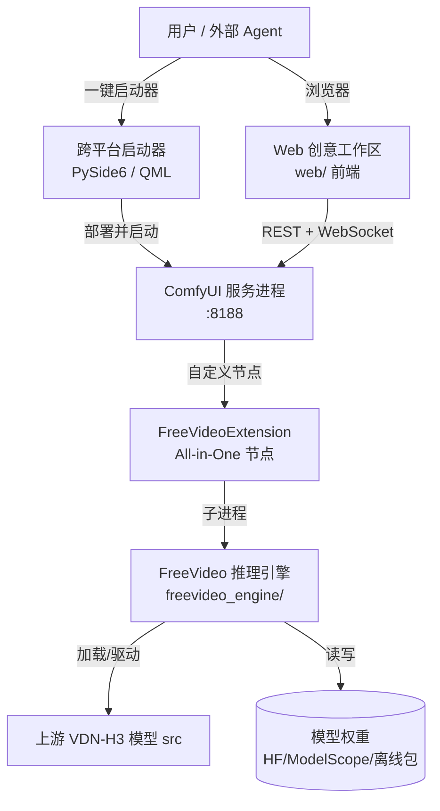

# 01 · FreeVideo 项目概览与定位

> 本文档从系统架构师视角，对 `FreeVideo` 仓库的源代码进行整理、分析与总结。
> 阅读顺序：本篇（定位）→ `02` 技术栈与仓库布局 → `03` 整体架构 → 后续各子系统专题。

## 1. 它是什么

FreeVideo 是一个**面向消费级 GPU 的本地视频生成推理引擎**，核心目标是在 **最低 8 GB 显存 / 16 GB 内存** 的机器上，本地运行 **MiniMax H3 / VDN-H3** 模型生成视频。

- 它并非从零实现 H3 模型，而是**加载、打补丁、并按硬件做内存与精度自适应**地驱动上游模型（`src` 包，来自 OpenVDN 的 VDN-H3 / Video DeltaNet）。
- 它主要以 **ComfyUI 自定义节点插件** 的形态提供给用户，并附带一套**跨平台一键启动器**（Windows / macOS / Linux），自动装配 ComfyUI、运行时环境与模型权重。

## 2. 关键事实

| 项 | 值 |
|---|---|
| 引擎包名 | `freevideo-engine` |
| 引擎版本 | `2026.9.16.41444` |
| Python 要求 | `>=3.12,<3.13`（实际锁定 `3.12.3`） |
| 许可证 | 代码 Apache-2.0；模型权重受 MiniMax H3 Community License 约束（含地域与使用限制） |
| 上游依赖 | OpenVDN VDN-H3、ComfyUI、Diffusers、SageAttention、PySide6（启动器）、Qt for Python |
| 入口命令 | `freevideo`（→ `freevideo_engine.cli:main` → `freevideo_engine.managed` 调度器） |

## 3. 支持的硬件与平台

- **CUDA（Windows / Linux）**：GeForce 与 RTX 30 系用 **int8（ConvRot）**，工作站/数据中心卡用 **FP8**。
- **Apple Silicon（macOS arm64，预览）**：统一内存，仅允许经校验的 int8 预处理模型。
- **Linux 服务器**：可 `freevideo server --listen 0.0.0.0` 提供局域网访问。

## 4. 核心能力（面向用户）

- **硬件自适应执行**：按 GPU 选择权重格式（int8 / FP8）、自动探测可用注意力内核（cudnn / flash / sage2 / fa2 / fa4）。
- **低显存推理**：权重流式加载、异步预取、分块计算，峰值显存极低。
- **多模态输入**：文本提示、首/尾帧、图像/视频/音频参考。
- **社区 LoRA**：在工作流中直接使用 MiniMax H3 LoRA。
- **ComfyUI 创意工作区**：双通道采样、批量生成、历史记录；可切到节点视图精细控制。
- **AI 智能体驱动**：可被 Claude Code / Codex / FreeToken 等外部 Agent 通过 REST + SSE（含 OpenAPI 与 MCP）自动生成视频。
- **一分钟长视频与剪辑视图**：长视频分段续接（chain），时间线剪辑、导出。
- **一键部署**：Windows / Mac / Linux 启动器自动装配 ComfyUI、运行时与模型，支持离线安装（模型包）。

## 5. 高层上下文图



## 6. 仓库顶层布局

```
FreeVideo/
├── freevideo_engine/      # 核心 Python 引擎（~410 个 .py）+ 资源 JSON
├── web/                   # ComfyUI 内的前端（原生 ES Modules，无构建步骤）
├── scripts/               # 打包 / 启动器 / 校验辅助脚本（23 个）
├── example_workflows/     # 内置默认工作流 JSON（All-in-One）
├── constraints/           # 约束说明文本
├── docs/                  # 既有文档（平台指南 / LoRA / 执行规划等）
├── pyproject.toml         # 构建与依赖定义
├── freevideo / .cmd / .ps1  # 平台启动脚本（bootstrap 工具链）
├── setup.sh / .cmd / .ps1  # 安装脚本
├── freevideo_source_bootstrap.py  # 冻结的可信更新锚点（Ed25519 校验）
├── freevideo_ed25519.py         # 从零实现的 Ed25519 验签
└── freevideo_update_keys.py     # 受信任的公钥
```

后续文档将逐层拆解上述每个子系统。
