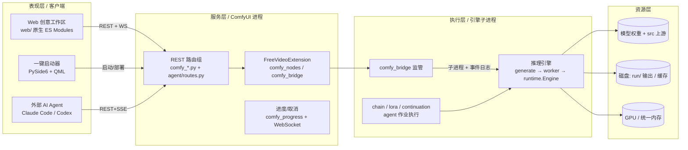
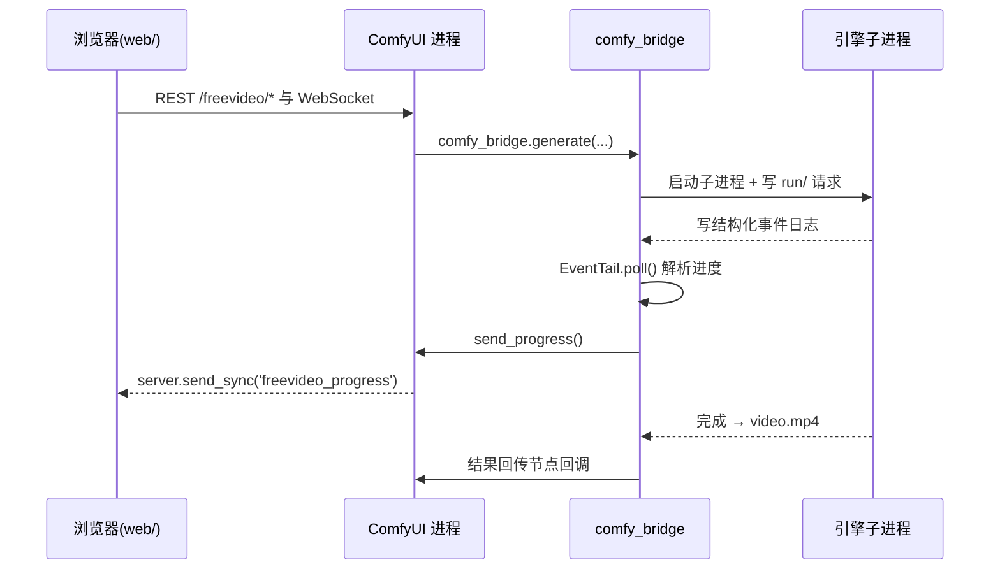

# 03 · 整体架构与分层

> 本篇给出 FreeVideo 的**分层架构总图**与各层之间的通信契约，是理解后续所有专题文档的“地图”。

## 1. 四层架构模型

## 2. 各层职责

### 表现层
- **Web 前端**（`web/`）：纯原生 JS，作为 ComfyUI 扩展挂载；含创作面板(studio)、节点视图、剪辑视图(editor)、AI 全自动(autopilot) 四视图。
- **一键启动器**（`modern_launcher.py` + `launcher/Main.qml`）：PySide6/QML 桌面应用，负责安装、启动、更新、离线导入；用 Software 渲染以免占用生成用 GPU。
- **外部 Agent**：通过 `/freevideo/agent/v1/*` 的 REST + SSE 接口驱动生成（详见 `10`）。

### 服务层（ComfyUI 进程内）
- `comfy_entrypoint()`（`__init__.py`）注册 `FreeVideoExtension` 与全部 REST 路由组。
- `comfy_nodes.py` 定义 6 个节点（All-in-One `FreeVideoGenerate`、Media、Reference、LoRA、LoRAStack、Frames）。
- `comfy_bridge.py` 是**引擎子进程的监管者**：拼 CLI 命令、写 `run/` 目录、轮询事件日志、转发进度。
- `comfy_progress.py` 将进度经 ComfyUI 自带 WebSocket 推送（`freevideo_progress` 事件），并提供 `GET /freevideo/progress` 快照。

### 执行层（隔离子进程）
- 引擎不运行在 ComfyUI 进程里：`comfy_bridge.generate` 启动 `freevideo_engine.managed generate` 子进程，在**独占 GPU 锁**下运行。
- 子进程内部：`generate.py`（规划/准入/派发）→ `worker.py`（采样+解码）→ `runtime.Engine`（模型加载与自适应）。

### 资源层
- 模型权重来自 HF / ModelScope / 离线包；上游 `src` 通过 `add_vdn()`（`paths.py`）注入。
- 输出落在 `output/FreeVideo/<date>/<run>/video.mp4`；进度/事件写入 `run/` 日志由桥接层轮询。

## 3. 关键通信契约（三类通道）

1. **引擎 ↔ ComfyUI 进程**：**无 socket**，通过子进程 + 事件日志文件轮询（`EventTail`）。
2. **ComfyUI 进程 ↔ 浏览器**：复用 ComfyUI 既有 WebSocket（自定义事件 `freevideo_progress`）+ 一组 `/freevideo/*` REST 路由。
3. **外部 Agent ↔ 服务层**：独立的、Bearer Token 保护的 REST + SSE 接口（`/freevideo/agent/v1/*`），与上面两条通道解耦。

## 4. 设计要点（架构师视角）

- **进程隔离**：引擎在受监控子进程中运行，带 RAM/GPU 护栏，失败可 resume（保留采样检查点）。
- **关注点分离**：规划（CPU）、条件化（编码子进程）、采样（引擎）、解码（引擎）、剪辑（CPU 媒体检查）各自独立。
- **自适应而非硬编码**：权重格式、注意力内核、分块/并行度由“规划层 + 运行时层”按硬件事实动态决定（见 `05`）。
- **双入口**：既服务人类（Web/启动器），也服务机器（Agent API），两者共用同一执行核心。
