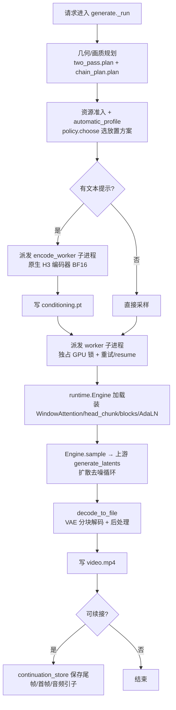

# 04 · 推理引擎核心与生成流程

> 本篇聚焦 `freevideo_engine` 的生成主链路：从请求规划到 MP4 落盘。内存与精度自适应细节见 `05`。

## 1. 关键文件与角色

| 文件 | 角色 |
|---|---|
| `generate.py` | 请求入口、资源准入、派发（父进程，不持张量） |
| `worker.py` | 隔离的采样 + 解码 worker（一次 Engine 请求） |
| `runtime.py` | `Engine` 类：模型骨架加载、打补丁、采样入口 |
| `attention.py` | `WindowAttention`：全局+窗口注意力与后端选择 |
| `head_chunk.py` | 把 H3 激活按 head 分组限界（省显存的分片线性分支） |
| `blocks.py` | `install_bounded_blocks`：融合 H3 块、丢弃已消费激活、分块 FF |
| `adaln.py` | 预计算 AdaLN 调制表（`CachedModulation` / `TableCache`） |
| `conditioning.py` | 文本条件化契约（`prompt_embeds [1,L,5120]` + `text_token_tags`） |
| `continuation.py` | 视频分段续接的固定前缀上下文管理器 |
| `decode.py` | `decode_to_file`：加载视频 VAE、分块解码、写 MP4 |
| `latent_upscale.py` | 两通道精修用的 latent 上采样器 |
| `media_encoding.py` | 参考图/视频/音频 → VAE latent 的条件化边界 |

## 2. 端到端生成流程

## 3. 调度与隔离

- `generate.py:child()` 在**独占 GPU 锁**（`runtime_lock`）下 `subprocess` 派发 worker，并监控 RAM/GPU。
- **编码**与**视频生成**是不同子进程：文本条件化在 `encode_worker` 中完成（可缓存），视频 worker 在 `adaptive.execute_attempts()` 包裹下运行，失败可从保留的检查点 resume。
- 设计意图：把“重对象生命周期 + 显存峰值”限制在短生命周期子进程内，主进程保持稳定。

## 4. 模型适配方式（打补丁而非重写）

FreeVideo **不重新实现** H3 前向，而是对上游 `src.models` 做 monkey-patch：

- `runtime.Engine.__init__` 加载权重骨架、校验 manifest、构建 `WindowAttention`、安装分片注意力/head-chunk/限界块前向，并接入权重流式与 offload。
- `sample()` → `_sample()` 打开 `continuation.sampling` 前缀上下文、创建 `LayerOffloader`、调用上游 `generate_latents(self.transformer, ...)`（真正的去噪循环）。返回 `(latents, audio, sampled_metrics)`。
- 所有模型代码（`blocks/head_chunk/attention/adaln`）都“放置感知”：无论张量落在 GPU、pinned host 还是流式加载，都保持相同的算术分区。

## 5. 两通道采样与长视频

- **两通道（two-pass）**：`two_pass.plan` 决定先半分辨率预览、再全分辨率精修；`latent_upscale.py` 在两通道间做 latent 上采样。
- **长视频链（chain）**：超过 30s 由 `chain_plan.plan` 切成重叠 block（`OVERLAP=22` 帧），交由 `chain_runner` 按依赖续接生成，详见 `08`。

## 6. 解码与媒体输出

- `decode_to_file` 加载视频 VAE（`AutoencoderKLMiniMaxH3`），可按规划做 `LayerOffloader` / `TileDecoder` / 流式权重；分块解码 + FP32 归一化 + 色彩后处理 → `encode_video` 写 MP4。
- `decode_stream.py` 流式解码原始时序分块；`decode_prefetch.DecoderReadAhead` 在采样最后几步提前读解码器检查点，重叠 I/O。
- 续接视频会隐藏尾帧（`hide_tail`），保证多段拼接无缝（见 `08`）。
