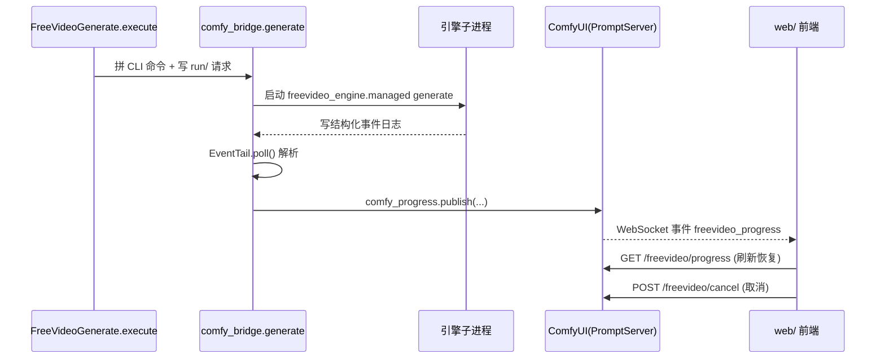

# 06 · ComfyUI 集成层

> FreeVideo 在 ComfyUI 中以 **一个扩展 + 六个节点 + 一组 REST 路由** 的形态出现。本篇拆解其注册、桥接协议与关键集成点。

## 1. 节点注册（ComfyUI V3 API）

- `__init__.py` 是自定义节点包：设置 `WEB_DIRECTORY='./web'`，`comfy_entrypoint()` 注册全部 REST 路由组并返回 `FreeVideoExtension`。
- `FreeVideoExtension(ComfyExtension)` 的 `get_node_list()` 返回 **6 个节点**（`comfy_nodes.py`）：

| 节点 | 说明 |
|---|---|
| `FreeVideoGenerate` | **All-in-One**（`FreeVideo · Video + Audio`），输出节点，覆盖全部生成面 |
| `FreeVideoMedia` | 统一素材面板（自定义类型 `FREEVIDEO_MEDIA`） |
| `FreeVideoReference` | 参考图/视频/音频（类型 `FREEVIDEO_REFERENCES`） |
| `FreeVideoLoRA` / `FreeVideoLoRAStack` | LoRA 与 LoRA 栈（类型 `FREEVIDEO_LORAS`） |
| `FreeVideoFrames` | 帧相关辅助 |

- 节点用声明式 `define_schema()`（`io.Schema`）描述输入/输出与 `hidden`，替代经典 `INPUT_TYPES`。
- All-in-One 的 `fingerprint_inputs` 返回 `float('nan')` 以强制重执行（输出在磁盘上）；`execute` 统一调用 `comfy_bridge.generate(...)`。

## 2. 引擎 ↔ UI 的两条通道（重点）

1. **引擎 ↔ ComfyUI 进程**：`comfy_bridge` **不**开 socket，而是拼出 CLI 命令 `[python,'-m','freevideo_engine.managed','generate',...]`，写 `run/` 目录（`comfy-request.json`、`prompt.txt`、`workflow.json`、输出 `video.mp4`），监管子进程；进度来自引擎事件日志（`EventTail` 轮询 → `progress_message` → `send_progress`）。
2. **ComfyUI 进程 ↔ 浏览器**：复用 ComfyUI 既有 WebSocket，自定义事件 `freevideo_progress` 由 `comfy_progress.publish` 推送；另有 `GET /freevideo/progress` 快照供刷新/重开标签页恢复。

> 前端**从不直接**连引擎子进程，只与 ComfyUI 进程通信，再由 `comfy_bridge` 调起引擎。

## 3. REST 路由组（全部挂在 `/freevideo/*`）

在 `comfy_entrypoint()` 中注册，关键组：

- **进度/结果**：`comfy_progress.py`（`/progress`、`/report/{id}`、`/frame-preview/{id}`、`/cancel`、`/queue/first`）
- **能力**：`comfy_capabilities.py`（`/capabilities`）
- **链式长视频**：`comfy_chain.py`（`/chain/*`）
- **续接**：`comfy_continuation.py`
- **剪辑**：`comfy_editor.py`（`/editor/*`）
- **媒体/库/分享/上传**：`comfy_media` / `comfy_library` / `comfy_share` / `comfy_upload`
- **安装/更新**：`comfy_setup` / `comfy_updates` / `comfy_launcher_api`
- **Agent**：`agent/routes.py`（`/agent/v1/*` 与 `/agent` 聊天层，见 `10`）

## 4. 三个关键集成点

- **`comfy_chain.py`**：长视频“链”。`ComfyHost` 把每个 block 作为普通 ComfyUI `/prompt` 请求提交（`submit/status/cancel`），`join` 调 `chain_join.join_outputs`；`split_texts` 用提示词 VLM 服务把一段描述拆成 N 段。`register()` 挂载 `/chain`、`/chains`、`/chain/{id}...`。
- **`comfy_continuation.py`**：实现“从已有 MP4 续接/延展”（Generate 节点的 `continue_from` / `frames` 输入），处理音频引子淡入、`part_steps` 强制 8+3 两通道步数等。
- **`comfy_editor.py`**：独立于生成的非线性时间线编辑器，`/freevideo/editor/*`（projects/sources/waveform/import/export），编辑是 CPU 侧有界媒体检查，导入不会产生新创作。

## 5. `freevideo` 命令实际启动什么

- 入口 `cli:main` → `managed.py` 调度器（子命令如 `open|setup|server|status|stop|generate`）。
- **安装**（引擎+模型+ComfyUI+节点）：`comfy_service.install()` → `comfy_host.prepare()`（构建 ComfyUI venv）+ `comfy_launcher_runtime.deploy()`（把节点包放入目标 ComfyUI）。
- **服务（Linux 终端）**：`comfy_service` 的 `server`/`open` 启动 `python -m freevideo_engine.comfy_service run` 后台服务，并通过 `access_proxy` 提供可选局域网访问。
- **桌面（Win/Mac）**：`modern_launcher` / `comfy_launcher` 驱动同一套 `comfy_launcher_runtime.Controller` 与 `comfy_setup.Setup`。
- **生成实际运行处**：不是 CLI，而是 `comfy_bridge` 监管的 `freevideo_engine.managed generate` 子进程；产物落在 `output/FreeVideo/<date>/<run>/video.mp4`。
