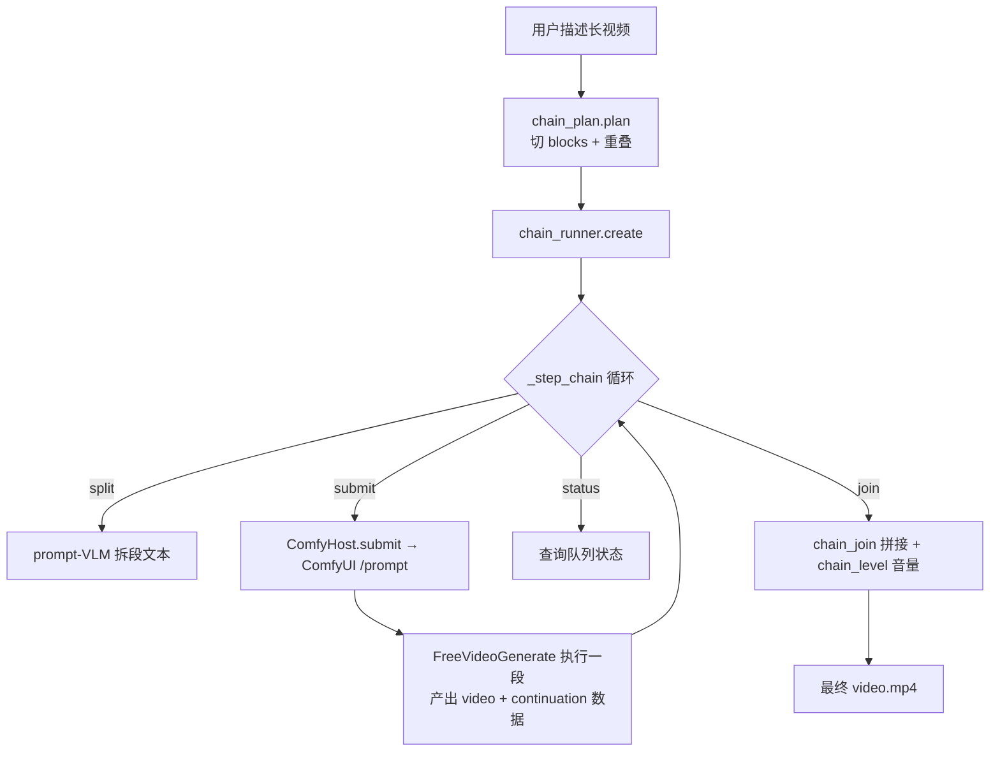

# 08 · 长视频链（Chain）与续接（Continuation）机制

> “一分钟长视频”由 **chain（按依赖续接的 block 批次）** 与 **continuation（从已有视频续接）** 两套互补机制实现。本篇拆解其模型与执行。

## 1. 什么是 Chain

一个 **chain** 是**可持久化、可恢复**的一批 **block（生成片段）**，彼此续接以生成单段生成无法容纳的更长的视频。分六文件 + 两集成点：

| 文件 | 角色 |
|---|---|
| `chain_plan.py` | 纯“时长→blocks”数学。`plan()`：<30s 返回单段；≥30s 切重叠 block。常量 `FPS,UNIT,OVERLAP=24,17,22`；`SINGLE_SECONDS,BLOCK_SECONDS,MIN_PART_SECONDS=30,15,10` |
| `chain_store.py` | 版本化工作流快照 + 原子回执。`MAX_PARTS=8`（首段 + 7 续接）。定义 `CHAIN_STATES/BLOCK_STATES/OUTPUT_STATES/SPLIT_STATES`，`save/load_all/detail/summary/leading_blocks` |
| `chain_runner.py` | `ChainRunner`：单后台调度线程（`_work→step→_step_chain`），按 `after/before` 依赖提交普通 host prompt。动作：split / submit / status / cancel / join。中断经 `recover` 集合自动恢复 |
| `chain_join.py` | `join_files/join_outputs`：把各 block 视频按包拼接为一个 `video.mp4`，修复音频接缝 |
| `chain_leads.py` | 每段接缝音频存为 `<chain>.<index>.lead.npz`，从共享 store 拷出以免被清理 |
| `chain_level.py` | `voiced()/plan()/Shaper`：保持续接段音量与第一段的响度一致，分段时间增益 + 低架，0.5s 缓入，不溢出接缝 |

## 2. Chain 执行模型

- **依赖关系**：block 间用 `after`/`before` 串联；续接段需重算 `OVERLAP=22` 帧以衔接前段。
- **拆分文本**：`split_texts()` 调用本地提示词 VLM 服务把一段描述拆成 N 段。
- **提交**：`ComfyHost.submit()` 把每个 block 作为普通 ComfyUI `/prompt` 请求提交；`block_context/block_finished` 把每段 `FreeVideoGenerate.execute` 的运行挂回 runner。
- **拼接**：`chain_join.join_outputs` 拼接视频并修复音频接缝，`chain_level` 做音量归一，保证语音跨接缝一致。

## 3. Continuation（从已有视频续接/延展）

`continuation.py` / `continuation_store.py` / `continuation_tail.py` 实现“继续一段已存在 MP4”：

- 常量 `OVERLAP_FRAMES=22`、`LEAD_IN_*` 音频窗口、`FIRST_FRAME_*`（续接段的参考图即整片首帧），`supported()` 要求 `cuda`/`mps`。
- 解码后若视频可续接，`continuation_store.save` / `continuation_tail` 保存重叠尾帧、首帧/首声、音频引子，供下一段作为上下文续接。
- `comfy_continuation.py` 在服务层落地：处理 Generate 节点的 `continue_from` / `frames` 输入、`audio_lead_in` 接缝淡入、`part_steps` 强制 8+3 两通道步数。

> 两者关系：chain 的 `after/before` 依赖与每段返回的 `continuation` 数据，正是实现“两通道采样器的固定前缀续接”——每段复用前段素材作为上下文，从而把单段上限（约 30s）扩展到分钟级。

## 4. 设计要点

- **持久化 + 可恢复**：链状态落盘，中断可 `resume`，适合分钟级长任务的健壮性。
- **接缝处理是难点**：视频重叠 + 音频引子淡入 + 音量归一三者配合，保证拼接听感无缝。
- **复用同一生成核心**：chain/continuation 不另写生成逻辑，复用 All-in-One 节点与续接数据。
