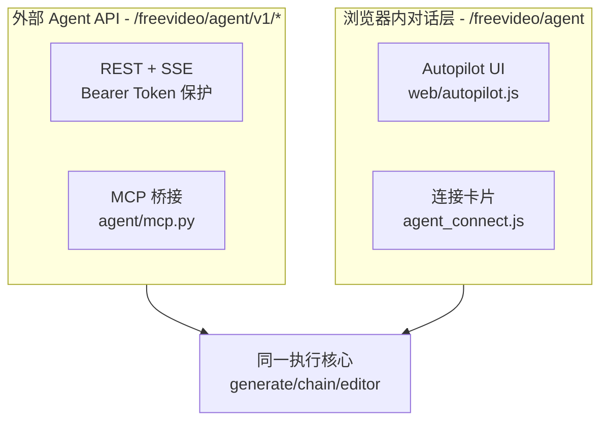
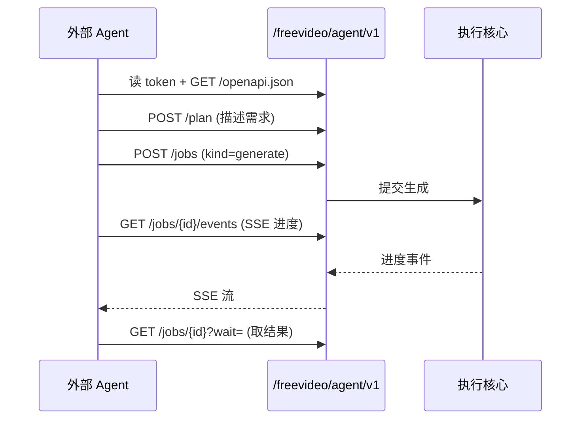

# 10 · AI 智能体（Agent）接口

> FreeVideo 可被外部 AI Agent（Claude Code / Codex / FreeToken）自动驱动生成视频。本篇拆解其对外 API 与浏览器内 Autopilot 层。

## 1. 两套 Agent 接口

- **`/freevideo/agent/v1/*`**：面向外部 Agent 的 **REST + SSE** 接口，**Bearer Token 保护**，JSON 进出。Token 位于 `<安装目录>/agent/token`，本地 Agent 与内置 MCP server 从磁盘读取（**不下发到浏览器**）。由 `agent/routes.py`（`ensure_token`、`token_path`）管理。默认开启（`FREEVIDEO_AGENT=0/false/...` 才关闭）。
- **`/freevideo/agent`（无 v1）**：浏览器内对话层，驱动 **Autopilot** UI（`autopilot.js`、`autopilot_chat.js`、`chat_data.js`、`agent_connect.js`、`agent_activity.js`）。

> 注意：`comfy_launcher_api.py`（`/freevideo/launcher/*`）是**桌面启动器**的握手接口，不是 Agent 接口。

## 2. 外部 Agent API 端点（`agent/routes.py`）

- **发现**：`GET /freevideo/agent/v1`、`/capabilities`、`/guide`、`/schema`、**`/openapi.json`**（完整 OpenAPI 文档）、`POST /plan`
- **作业（Jobs）**：`POST /jobs`、`GET /jobs`、`GET /jobs/{id}`（`?wait=`）、`POST /jobs/{id}/cancel`、`POST /jobs/{id}/resume`、`GET /jobs/{id}/events`（**SSE** 进度流）。支持 `X-FreeVideo-Client` 与 `Idempotency-Key`。
- **会话/确认/导入**：`POST|GET /sessions`、`…/events`、`…/stop|resume|stage`；`GET /confirmations`；`POST|GET /imports`
- **媒体/工具**：`POST /media`、`GET /media/{kind}/{file}/file`、`POST /media/inspect|frame|edit|contact-sheet`；`GET /library`、`GET /library/{day}/{run}`
- **白盒预览**：`/whitebox/next|presets|try`、`/whitebox/{id}/video|failed`

**作业种类**（`info()` 返回）：`generate, assemble, vlm, image, enhance, export, listen, image_edit`。

### 外部 Agent 驱动生成的典型流程

## 3. 浏览器内 Autopilot

- `agent_connect.js` 的 `connectionSentence` 生成一段“连接句”，粘贴到 Claude Code / Codex / FreeToken 即可让其在浏览器外驱动本机 FreeVideo。
- `agent_session.js` 用“页面会话”鉴权（`GET /freevideo/agent/session` 拿 `X-FreeVideo-CSRF`），Agent 的 bearer token 不下发到页面。
- `autopilot_chat.js` + `chat_data.js` 管理多会话与任务卡片（前端轮询）。

## 4. Agent 包内部结构（`freevideo_engine/agent/`）

`agent/` 是一个完整的子系统目录，涵盖：路由（`routes.py`、`access.py`）、作业（`jobs.py`、`operation_receipts.py`）、会话（`sessions.py`）、媒体（`media.py`、`images.py`、`image_runtime.py`）、导入（`imports.py`、`private_file.py`）、白盒（`whitebox.py`、`whitebox_presets.py`）、导演/剧本（`builtin_director.py`、`drama.py`、`productions.py`、`production.py`）、项目（`projects.py`、`editor_runtime.py`）、长度规划（`length.py`、`forecast.py`）、MCP（`mcp.py`）、Schema（`schema.py`、`spec.py`、`guide.py`）、客户端（`client.py`）、ComfyUI 适配（`comfy.py`）、附件（`attachments.py`）、错误（`errors.py`）、资产（`assets.py`）。

## 5. 设计要点

- **人机共用执行核心**：Web/启动器服务于人，Agent API 服务于机器，两者都落到同一 `generate/chain/editor` 核心。
- **安全边界清晰**：Agent Token 仅在本地磁盘与 MCP server 间流转，浏览器只拿 CSRf 会话令牌；接口带 Bearer Token 与幂等键。
- **自描述**：提供 `/openapi.json` 与 `/guide`，便于 Agent 自动发现能力，无需硬编码。
